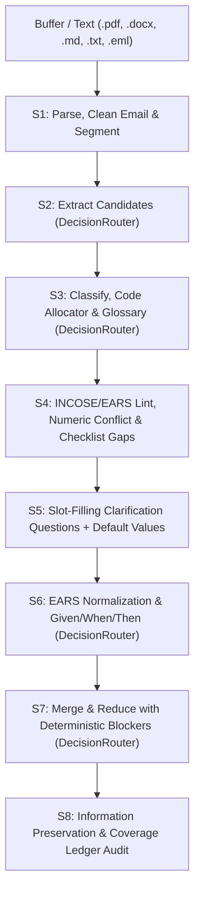

# Đặc tả Tính năng: Pipeline Chuẩn hoá 8 Giai đoạn & Bộ Quyết định 3 Bậc (`@srs-tool/pipeline`)

## 1. Mục tiêu & Mã Yêu cầu Liên quan
- **Vai trò:** Trái tim xử lý ngôn ngữ tự nhiên & kỹ thuật yêu cầu song ngữ Việt–Anh của toàn hệ thống. Chứa logic **thuần hàm / không phụ thuộc CSDL** của trọn vẹn 8 giai đoạn (`S1 → S8`), **Bộ định tuyến quyết định 3 bậc (`DecisionRouter`)**, cổng mô hình cục bộ (`LocalModelPort`) và **Sổ phủ (`CoverageLedger`)**.
- **Mã yêu cầu đặc tả:**
  - Tiếp nhận & Phân đoạn: `FR-ING-001..003`, `FR-ING-005..008` (đọc `.pdf`, `.docx`, `.md`, `.txt`, `.eml`, từ chối PDF scan không có text layer, làm sạch chuỗi email, gắn ngôn ngữ từng đoạn).
  - Trích xuất, Phân loại & Thẩm định: `FR-REQ-001..005`, `FR-REQ-013`, `FR-REQ-015`, `FR-ARC-002` (`S2` trích ứng viên, `S3` phân loại loại yêu cầu / nền tảng / ASR / cấp mã `FR-WEB-001` / trích thuật ngữ `Glossary`, `S4` lint EARS + INCOSE + phát hiện mâu thuẫn số học + kiểm tra thiếu sót theo checklist nền tảng).
  - Làm rõ, Chuẩn hoá, Gộp & Kiểm chứng ngược: `FR-REQ-006..012`, `FR-REQ-017..020` (`S5` sinh câu hỏi điền khe kèm giá trị gợi ý, `S6` chuẩn hoá sang mẫu câu EARS + Given/When/Then, `S7` gộp trùng lặp có điều kiện chặn tất định, `S8` đối soát bảo toàn số liệu/phủ định/tình thái và kiểm toán Sổ phủ).
  - Giảm phụ thuộc LLM & Chất lượng: `NFR-QUAL-001..005`, `NFR-LLM-001..004`.

---

## 2. Cấu trúc Thư mục & Phụ thuộc
- **Đường dẫn:** `srs-tool/packages/pipeline`
  - `src/decision/router.ts`: `DecisionRouter`, `StageThresholds`, `Decider<TIn, TOut>`.
  - `src/decision/local-model.port.ts` *(Tạo mới ở Phase 1)*: Giao diện `LocalModelPort` cho Tier 1 (embedding 384 chiều, NLI contradiction/entailment, phân loại yêu cầu).
  - `src/ledger/coverage.ts`: `CoverageLedger` kiểm tra bất biến bảo toàn đoạn văn bản nguồn.
  - `src/text.ts`: Bộ tiện ích tách từ/tách câu Unicode hỗ trợ chuẩn tiếng Việt có dấu (`wordsRegex`, `countWord`, `splitSentences`).
  - `src/stages/`:
    - `s1-parse-segment.ts`: Phân tích `.txt`, `.md`, `.eml`, `.docx` (`mammoth`), `.pdf` (`unpdf`), tách đoạn không cắt giữa câu, giữ ngữ cảnh tiêu đề & bảng.
    - `s2-extract.ts`: Trích xuất câu ứng viên yêu cầu (nhận diện động từ tình thái `phải/cần/nên/shall/must/should`, mẫu User Story, mã yêu cầu có sẵn, danh sách gạch đầu dòng dưới mục chức năng; loại trừ tiêu đề/lời chào/chữ ký).
    - `s3-classify-tag.ts`: Phân loại `functional`/`non-functional`/`constraint`/`interface`/`assumption`, gán nền tảng (`web`/`mobile`/`iot`/`shared`), gắn cờ `is_asr`, ước lượng ưu tiên MoSCoW và trích xuất ứng viên thuật ngữ song ngữ (`Glossary`).
    - `s4-issue-detector.ts`: Bộ quy tắc kiểm lỗi INCOSE (`INCOSE-001` từ mơ hồ, `INCOSE-002` câu ghép nhiều mệnh đề, `INCOSE-003` câu bị động thiếu chủ thể, `INCOSE-004` mệnh đề thoát hiểm, `INCOSE-005` NFR thiếu con số đo lường), `EARS-001`, bắt mâu thuẫn số học có quy đổi đơn vị (`2s` vs `500ms`, `CONFLICT-NUM`), và rà lỗ hổng `CHECKLIST-*`.
    - `s5-question-builder.ts`: Điền khe mẫu câu hỏi song ngữ theo từng `ruleId` + gắn `suggested_values` từ `loadPlatformDefaults`.
    - `s6-normalizer.ts`: Biến đổi an toàn câu yêu cầu thường / User Story sang mẫu câu EARS chuẩn song ngữ, sinh `acceptance_criteria` (`Cho trước / Khi / Thì` hoặc `Given / When / Then`), trích `QualityMetric` và `verification_method`.
    - `s7-merge-reduce.ts`: Phát hiện cặp yêu cầu trùng lặp (Jaccard từ vựng ở Tier 0, Cosine Embedding + NLI ở Tier 1, LLM ở Tier 2) kèm **bộ chặn tất định**.
    - `s8-coverage-checker.ts`: Đối chiếu từng yêu cầu sau chuẩn hoá/gộp với câu gốc để bảo toàn 100% số liệu, đơn vị, phủ định, mức bắt buộc (`FR-REQ-020`) và xuất báo cáo `CoverageLedger`.
  - `src/stages-1-4.ts` & `src/stages-5-8.ts` *(Tạo mới ở Phase 1)*: Các hàm điều phối thuần nối từng giai đoạn qua `DecisionRouter` và gom `DecisionLog[]`.
- **Phụ thuộc cho phép:** `@srs-tool/schemas`, `@srs-tool/knowledge`, `@srs-tool/llm`, `mammoth`, `unpdf`. **Tuyệt đối không** phụ thuộc `@srs-tool/db` hay BullMQ.

---

## 3. Đặc tả Luồng 8 Giai đoạn & Các Bất biến Kỹ thuật

### Các Quy tắc Nghiệp vụ Bắt buộc trong Code
1. **Từ chối PDF ảnh/scan (`FR-ING-008` ở `S1`):**
   - Giải mã PDF bằng `unpdf`. Nếu file mang định dạng PDF (`.pdf` / `application/pdf`, kích thước `> 0`) nhưng tổng văn bản trích xuất sau khi `.trim()` ít hơn `20` ký tự → ném lỗi nghiệp vụ có mã `SCANNED_PDF_UNSUPPORTED` với thông báo hành động rõ ràng yêu cầu cung cấp bản PDF có lớp văn bản hoặc `.docx`/`.txt`.
2. **Ma trận Chế độ của `DecisionRouter` (`FR-REQ-017`, `NFR-LLM-002`):**
   - `eco`: Chỉ chạy `tier0` + `tier1` (nếu có `LocalModelPort`), **0 lời gọi `tier2` (LLM)**. Nếu `confidence < lowThreshold` → trả về `status = 'pending_llm'` hoặc `'needs_review'`.
   - `standard`: Chạy `tier0` → nếu `confidence >= highThreshold` thì chốt ngay; nếu chưa đạt thì hỏi `tier1`; chỉ các mục rơi vào vùng mơ hồ mới gom lô gọi `tier2` (`llm-small`, nâng lên `llm-large` cho câu phức ở `S6`).
   - `thorough`: Ngưỡng `highThreshold` siết chặt hơn (`0.95`) và cho phép kiểm chứng chéo bằng `llm-large` ở `S6`/`S8`.
3. **Điều kiện Chặn Tất định khi Gộp ở `S7` (`FR-REQ-009`):**
   - Trước mọi điểm tương đồng từ vựng hay embedding, hàm `hasHardBlocker(reqA, reqB)` **bắt buộc trả về `true` (cấm gộp tự động)** nếu:
     - Tập hợp con số + đơn vị chuẩn hoá trong `reqA` và `reqB` khác nhau (VD: `200 ms` vs `500 ms`, `99.9%` vs `99.5%`, `20 MB` vs `50 MB`).
     - Một câu chứa từ phủ định (`không`, `cấm`, `tuyệt đối không`, `not`, `never`, `must not`, `shall not`) còn câu kia không có.
     - Khác loại đối lập (`constraint` vs `functional`) hoặc khác chủ thể tác nhân chính rõ rệt (`Quản trị viên` vs `Khách vãng lai`).
   - Khi gộp `duplicate` vào `primary`, danh sách `segment_id` nguồn của `duplicate` phải được gộp đầy đủ sang `primary`.
4. **Kiểm tra Bảo toàn Thông tin ở `S8` (`FR-REQ-020`):**
   - Mọi con số (`\d+(?:[.,]\d+)?`), đơn vị kỹ thuật (`ms`, `s`, `giây`, `phút`, `%`, `MB`, `GB`, `req/s`, `Hz`...), từ phủ định và mức độ bắt buộc (`phải`/`bắt buộc`/`shall`/`must`) có mặt trong `statement_original` **phải còn hiện diện** trong `statement` sau chuẩn hoá `S6`.
   - Nếu `S6` vô tình làm rơi bất kỳ yếu tố nào ở trên, `S8` phải khôi phục hoặc đánh dấu lỗi `PRESERVATION-001` (`severity: 'error'`) để chặn duyệt tự động.

---

## 4. Thực trạng Code Hiện tại & Lộ trình Triển khai

### Trạng thái hiện tại (`~55%`)
- **Đã chạy rất tốt:** `S1` (cho `.txt`/`.md`/`.eml`), `S2`, `S3`, `S4`, `DecisionRouter`, `CoverageLedger` và `stages-1-4.ts` đã có 15 unit tests xanh (`s1-s4.spec.ts`).
- **Còn thiếu / Cần nâng cấp:**
  1. `S1ParseAndSegment` nhận `content: string` thuần, chưa giải mã nhị phân `Buffer` cho `.docx` và `.pdf`, chưa chặn PDF scan (`FR-ING-008`). (`mammoth` và `unpdf` đã được thêm vào `package.json`).
  2. `S3ClassifyAndTag` chưa có hàm trích xuất thuật ngữ ứng viên cho bảng `glossary_terms`.
  3. `S5QuestionBuilder` mới có 4 mẫu cứng, chưa điền thực tế `{subject}` / `{{vague_term}}` từ văn bản yêu cầu, chưa sinh câu hỏi cho `CONFLICT-NUM` (hiển thị 2 con số xung đột) và `CHECKLIST-*` (lấy câu hỏi song ngữ từ YAML + `suggested_default`).
  4. `S6Normalizer.tier0` mới xử lý các câu vốn đã có từ khoá `Khi/Nếu/When/If` ở đầu câu; nếu câu thường dạng `"Hệ thống cần cho phép đăng nhập..."` hoặc User Story `"Là khách hàng, tôi muốn..."` thì hiện chỉ giữ nguyên văn và trả `confidence = 0.4` thay vì chuyển sang mẫu EARS Ubiquitous / Event-driven + sinh khung `Given/When/Then`.
  5. Chưa có file điều phối `src/stages-5-8.ts` kết nối `S5`, `S6`, `S7`, `S8` với `DecisionRouter` và chưa có unit test cho `S5 → S8`.
  6. Chưa có `LocalModelPort` cho Tier 1 và chưa có hàm gọi batch Tier 2 sang `LlmGateway`.

### Kế hoạch theo Phase
- **Phase 1:**
  - Tạo `src/decision/local-model.port.ts` định nghĩa `LocalModelPort`.
  - Nâng cấp `s1-parse-segment.ts` hỗ trợ `async execute(input)` (giữ thêm hàm đồng bộ cho text thuần nếu cần) đọc `Buffer` `.docx` qua `mammoth` và `.pdf` qua `unpdf` + kiểm tra PDF scan `< 20` ký tự.
  - Bổ sung `extractGlossaryCandidates` ở `s3-classify-tag.ts`.
  - Hoàn thiện `s5-question-builder.ts`, `s6-normalizer.ts`, kiểm tra chặt bộ chặn ở `s7-merge-reduce.ts` và bảo toàn tình thái/phủ định ở `s8-coverage-checker.ts`.
  - Tạo `src/stages-5-8.ts` (`runQuestionBuilding`, `runNormalization`, `runMergeAndReduce`, `runCoverageAndPreservation`) và xuất ra ở `src/index.ts`.
  - Viết `src/__tests__/stages-5-8.spec.ts` kiểm thử toàn diện `S5 → S8` và trích xuất `.docx`/`.pdf`.
- **Phase 3:**
  - Cài đặt các phương thức `tier2Batch` trong `stages-1-4.ts` và `stages-5-8.ts` gọi `LlmGateway.batchGenerate(...)` với Zod schemas cho các mục `DecisionRouter` chuyển lên bậc 2 ở chế độ `standard` / `thorough`.
- **Phase 4:**
  - Cài đặt adapter thực thi `LocalModelPort` bằng `@huggingface/transformers` (embedding đa ngôn ngữ `paraphrase-multilingual-MiniLM-L12-v2` 384 chiều + mô hình NLI nhẹ chạy CPU) và nối vào `tier1` của `S2`, `S4` (phát hiện xung đột ngữ nghĩa), `S7` (cosine similarity + NLI), `S8` (entailment check).

---

## 5. Tiêu chí Nghiệm thu & Kịch bản Kiểm thử
- [ ] Nạp Buffer `.docx` và `.pdf` có lớp văn bản vào `S1` tách được đầy đủ đoạn văn kèm `locator` (`page` / `line`) và nhận diện đúng ngôn ngữ `vi`/`en`; nạp PDF rỗng văn bản ném đúng lỗi `SCANNED_PDF_UNSUPPORTED`.
- [ ] Câu User Story tiếng Việt `"Là người dùng di động, tôi muốn nhận thông báo đẩy khi thiết bị mất kết nối quá 30 giây để kịp thời kiểm tra"` đi qua `S6` Tier 0 được chuẩn hoá sang câu EARS chuẩn, bảo toàn con số `30 giây`, trích được `rationale` và sinh tiêu chí `Cho trước / Khi / Thì`.
- [ ] Hai câu `"Hệ thống phải phản hồi trong 200 ms"` và `"Hệ thống phải phản hồi trong 500 ms"` bị `S4` bắt lỗi `CONFLICT-NUM`, được `S5` tạo câu hỏi chọn giá trị, và **bị `S7` chặn tuyệt đối không cho gộp tự động**.
- [ ] Nếu một bước biến đổi làm mất chữ `"không"` hoặc số `"99.9%"`, `S8` phát hiện chính xác phần tử bị mất (`missingNumbers` / `negationLost` / `modalityWeakened`).
